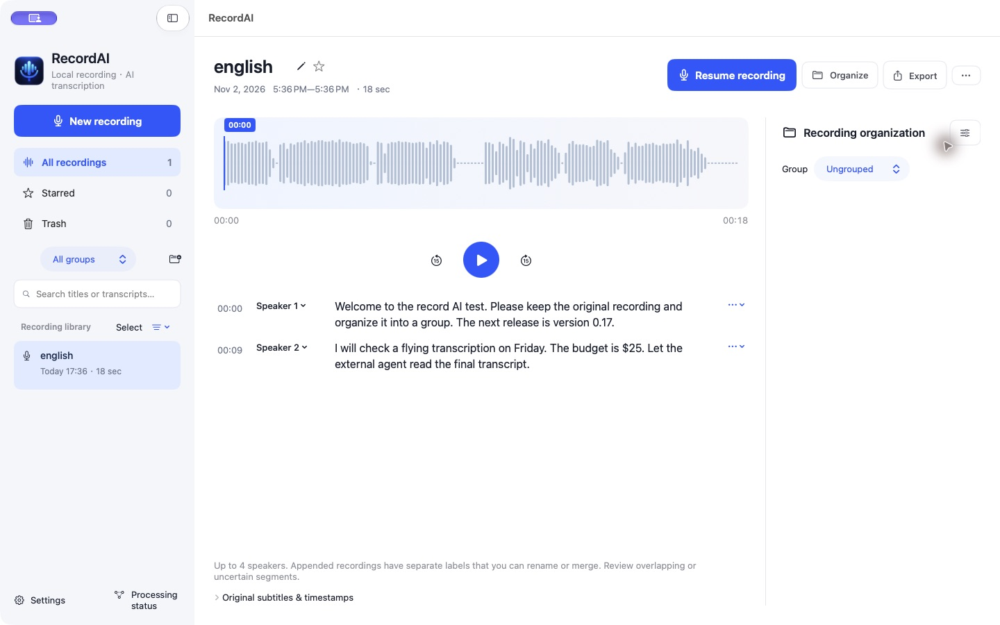
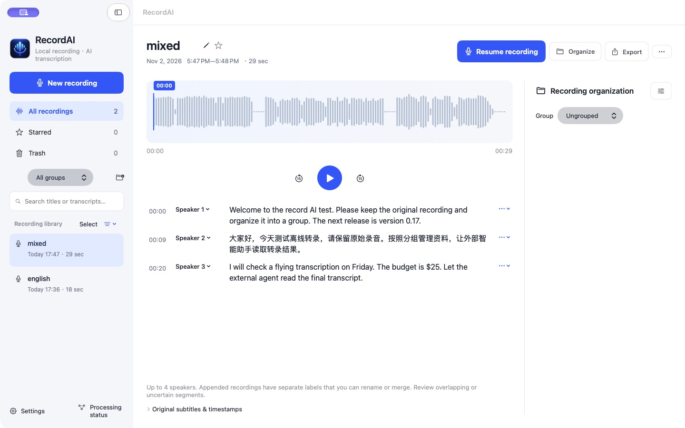
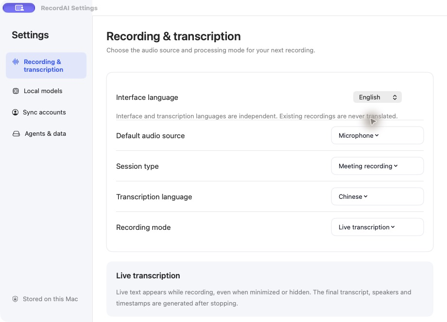
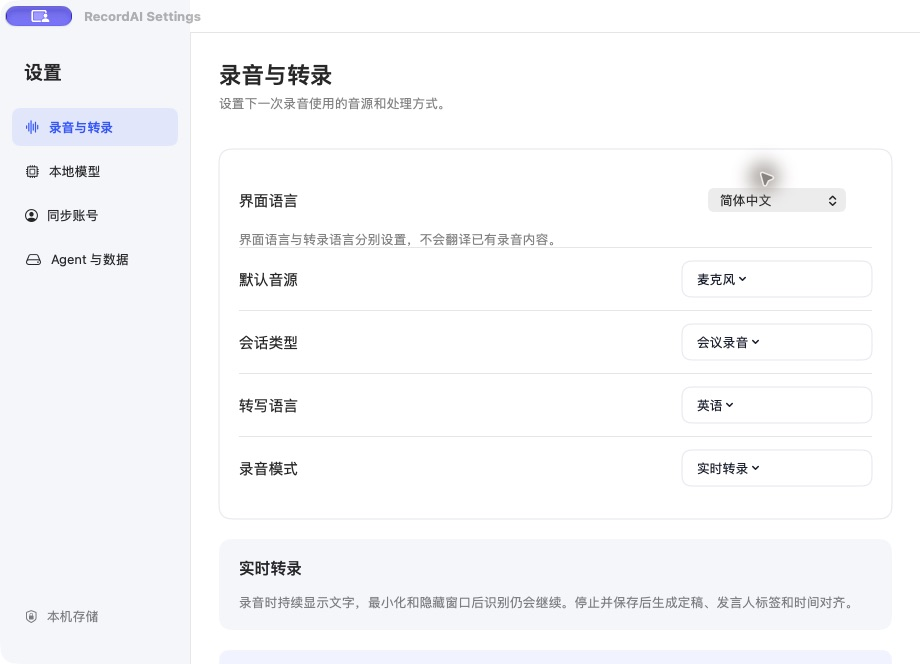
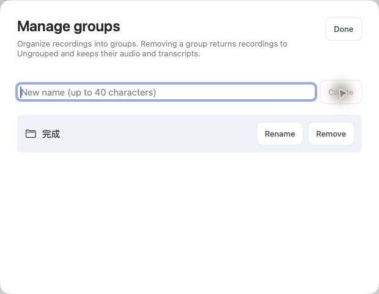
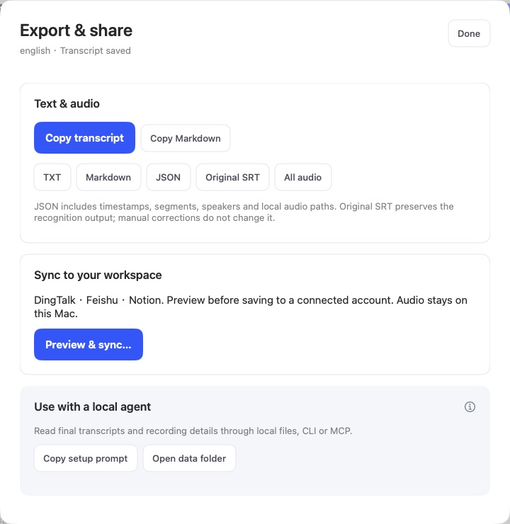

# 中英文界面、转录与 Windows 验证准备

2026-11-02，开发分支 `codex/bilingual-windows-validation`，基于 `53bb053`。本阶段改动已纳入 0.17.0 功能验证版，最终安装包验证见 [0.17.0 交付记录](../release-0.17.0/README.md)；已有 0.16.2 发布证据保留原有版本含义。

界面语言独立保存为跟随系统、简体中文或 English；转录语言独立保存为中文、英语或中英自动。设置中的说明明确：实时 Paraformer 为固定中英双语预览，最终 Qwen 转录遵循所选语言。修正自动模式下纯英文片段误用中文强制对齐策略的问题。没有新增模型下载或用系统 ASR 替换已有模型。

## 本机实际完成的验证

| 验证 | 结果与边界 |
| --- | --- |
| 英文本地实时预览 | 把合成英文 PCM 按真实帧协议送入新构建的 Paraformer，收到英文 commit；明确报告双语模型，不伪称强制英文 |
| 英语定稿及发言人对齐 | 新构建的 Qwen runtime 与真实本机模型执行，生成 TXT、SRT、段落 JSON；对齐后正文逐字保全 |
| 中英混合定稿与对齐 | 自动识别英文、中文、英文三部分，保留两种文字；对齐时间有效，正文与片段重组一致 |
| 原生客户端导入 | 空隔离库导入英语 WAV、点击转录，正文完成、两位发言人显示，首次 Agent 引导出现；再导入混合音频验证自动模式 |
| 原生页面 | 检查主库、四个设置页、模型详情、三类账号、Agent 引导、分组、导出、段落编辑和操作菜单。修正首页入口、处理状态及恢复/mini 提示遗漏；不等于完整设计册 44 页已全部验收 |
| 数据保全 | 英文界面新建中文分组“完成”，名称保持中文；界面中英切换并重启后，会议 JSON 和 Agent record.json 的文件字节不变；转录选择仍为 en |
| 回归 | 录音入口、mini、持续录音、音频混合、发言人编辑、库与分组、CLI/MCP、接入安装契约、账号授权及报告渲染均通过。大部分为隔离契约或模拟服务，不能当作真实硬件/账号验收 |
| 新测试 | 本地化资源、持久化、用户文字与自定义发言人保全、导出、Agent 快照独立性；4 个语言策略测试；15 个 Windows 可移植契约测试 |













模型/账号效果见 [模型详情](models-en.jpg)、[账号设置](accounts-en.jpg)。上述截图只含隔离库的合成语音，不使用个人录音。[实时引擎事件](live-en.jsonl)及本目录回归日志保留了对应验证范围。

## 原始输出与准确率边界

- 英文：[报告](en-report.json)、[正文](en-transcript.txt)、[字幕](en-transcript.srt)、[对齐段落](en-paragraphs.json)。
- 中英混合：[报告](mixed-report.json)、[正文](mixed-transcript.txt)、[字幕](mixed-transcript.srt)、[对齐段落](mixed-paragraphs.json)。
- [实际界面切换与 Agent 数据不变检查](ui-data-invariant.json)。

英文样本仍把 “offline transcription” 识别成 “a flying transcription”。字面 WER/CER 还把 “zero point one seven”→“0.17”、“twenty five dollars”→“$25” 等格式归一化计入差异，因此报告指标不能直接当作语义准确率。这只是清晰合成语音的功能验证，不代表会议、口音或噪声条件下的整体准确率。没有录制真实麦克风或系统声音。

## 重复验证

```zsh
python3 Scripts/check-localization.py
zsh Scripts/test-localization.zsh
python3 Tests/LanguagePolicySmoke.py
python3.12 -m unittest discover -s Tests/windows -v
RECORD_AI_UI_LANGUAGE=zh-Hans zsh Scripts/test-library-management.zsh
RECORD_AI_UI_LANGUAGE=zh-Hans python3 Scripts/test-recording-entry.py
RECORD_AI_UI_LANGUAGE=zh-Hans python3 Scripts/test-ui-contracts.py
python3 Scripts/test-agent-setup.py
```

真实引擎验收需要新构建的 ASR 运行时目录，以及已下载并校验的模型。脚本用本地 TTS 生成全新合成测试音频，不启用录音设备：

```zsh
python3 Scripts/test-bilingual-engine.py \
  --engine-dir '/path/to/current/RecordAI.app/Contents/Resources/Engine/ASR' \
  --model-root "$HOME/Library/Application Support/CoHearTranscribe/Models/ASR"
```

结果写入新的 `.build/bilingual-engine-*`，包括真实推理输出及实时 JSONL。语音模型目录仅用于读取。

## Windows 交付边界

已准备 [PowerShell 入口及用法](../../../Platforms/Windows/README.md)、设备枚举、WASAPI 麦克风/系统声音分轨采集、Qwen 与 faster-whisper 本地 CPU/CUDA 引擎基准、JSON 报告及自动测试。静音、设备变化、驱动异常、非法时间戳、参考文本丢失、缺少 Windows 环境均不会伪装为成功。

GitHub 工作流默认运行契约与设备枚举，可手动选择下载 tiny.en 并在 Windows Runner 的本地合成语音上实际跑 CPU 推理。该工作流的 15 项契约测试已在 Windows Server 2025 x64 / Python 3.12.10 上通过，PyAudioWPatch 安装成功；设备枚举为 unavailable，推理任务 skipped，见 [CI 记录](../release-0.17.0/windows-ci.json)。PowerShell 包装入口、Windows 原生模型性能、WASAPI 采集、长录音及设备切换仍待验证；不能据此交付 Windows 安装包。
