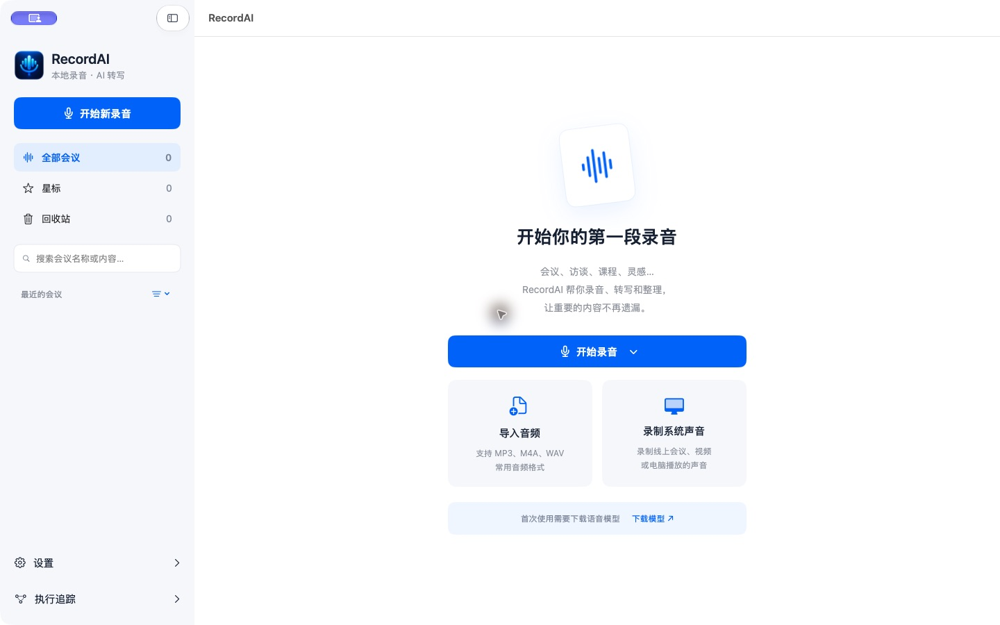
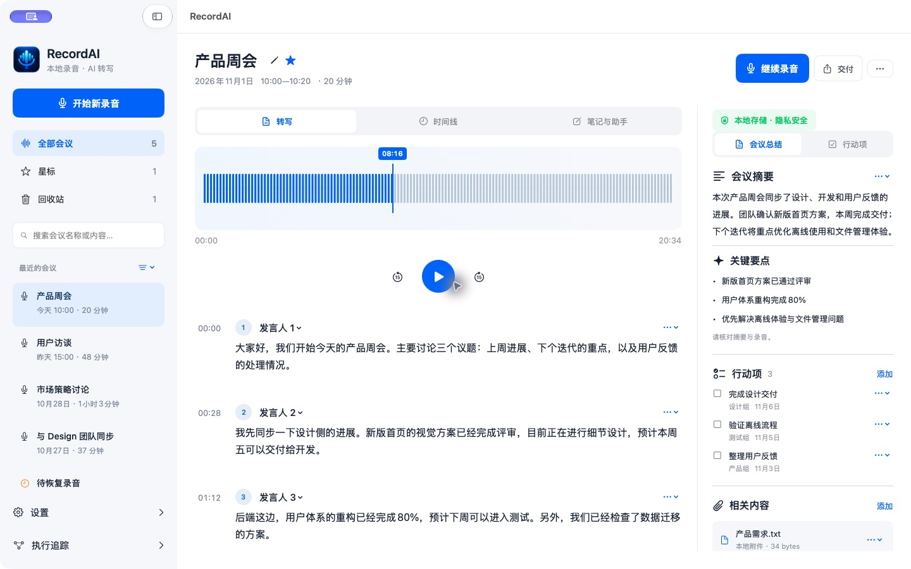
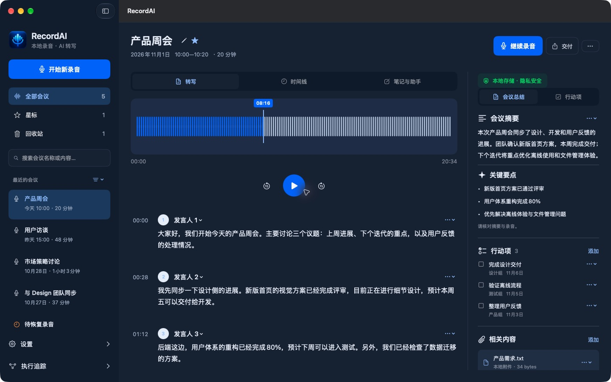

# RecordAI

RecordAI 是 macOS 本地录音与转录应用。它在本机处理音频，并提供 CLI 和 stdio MCP 接口供本机工具读取录音与转录结果。

**[下载 0.16.0 功能验证版](https://github.com/xsg22/recordai-macos/releases/tag/v0.16.0-functional.1)** · [DMG](https://github.com/xsg22/recordai-macos/releases/download/v0.16.0-functional.1/RecordAI-0.16.0-arm64.dmg) · [PKG](https://github.com/xsg22/recordai-macos/releases/download/v0.16.0-functional.1/RecordAI-0.16.0-arm64.pkg)

以下为原生客户端的实际截图，使用隔离演示资料。0.16.0 功能验证版优先交付已验证的本地转录主流程，完整 UI 逐页验收仍在进行，未宣称 100% 还原。






<details>
<summary>查看深色模式</summary>



</details>

[完整 44 页设计册](Docs/design-v2/index.html) · [逐页验收记录](Docs/UI验收.md) · [下载安装包](https://github.com/xsg22/recordai-macos/releases)

选择麦克风、系统声音或两者作为音源，录音时可暂停、继续或切换到 mini 录音条；完成后可回放、按时间定位转录并导出。首次使用需要下载语音模型。

没有麦克风也可以从首页导入音频，点击“开始转录”验证效果。已用 31 秒双人合成中文样本实测本地转录、发言人分段、段落回放、人工校正和 Markdown / 原始 SRT 导出，详见[实测结果与原始输出](Docs/design-v2/validation/import-e2e/README.md)。样本包含一处“设计组”识别为“测试组”的错误，不代表真实会议总体准确率。

首次使用时，在应用内下载并校验语音模型。模型文件不随源码或安装包分发，参见[模型下载](Docs/模型下载.md)。

## 开发环境

- Apple Silicon、macOS 14 或更新版本
- Xcode 命令行工具、CMake、Python 3.12
- 构建前准备官方 DWS 与 lark-cli 可执行文件，分别放在 `.vendor/dws/dws` 和 `.vendor/lark-cli/lark-cli`。`Scripts/build.zsh` 会校验固定版本的 SHA-256。

本地回归：

```zsh
mkdir -p .build
python3 Scripts/test-recording-entry.py
```

构建应用：

```zsh
COHEAR_STAGE_ONLY=1 RECORD_AI_BUILD_APP_PATH="$PWD/.build/local/RecordAI.app" /bin/zsh Scripts/build.zsh
```

模型权重、第三方运行时二进制、安装包、录音与授权凭据不纳入仓库。模型推理验收需要另外下载模型和测试音频。


## 构建与发布

重复的回归、打包、签名和安装包内容校验已合并到脚本：

```zsh
zsh Scripts/release.zsh
```

该命令及 GitHub 发布工作流会要求全部 UI 验收通过。仅准备本地候选包可运行 `zsh Scripts/release.zsh --candidate`；它不会发布。

明确选择先交付主功能时，可运行 `zsh Scripts/publish-functional-release.zsh v0.16.0-functional.1`。脚本核对实测证据后推送标签，由 GitHub 重新回归、打包并发布标明 UI 验收状态的功能验证 prerelease；不会修改 UI 验收结果。

详见[发布流程](Docs/发布流程.md)。Python 3.12 和语音引擎随安装包提供，最终用户无需另外安装 Python。
