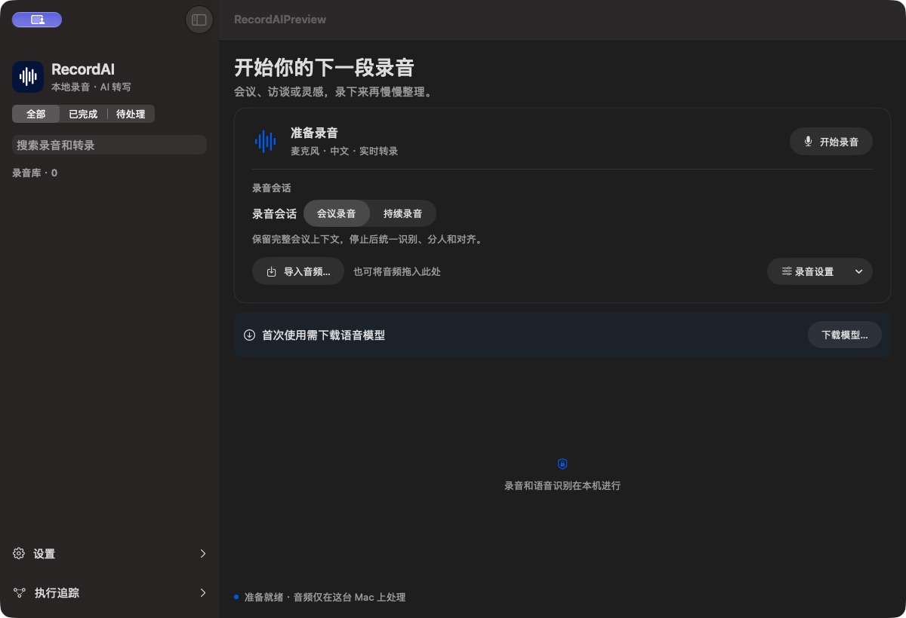

# RecordAI

RecordAI 是 macOS 本地录音与转录应用。它在本机处理音频，并提供 CLI 和 stdio MCP 接口供本机工具读取录音与转录结果。



选择麦克风、系统声音或两者作为音源，录音时可暂停、继续或切换到 mini 录音条；完成后可回放、按时间定位转录并导出。首次使用需要下载语音模型。

首次使用时，在应用内下载并校验语音模型。模型文件不随源码或安装包分发，参见[模型下载](Docs/模型下载.md)。

## 开发环境

- Apple Silicon、macOS 14 或更新版本
- Xcode 命令行工具、CMake、Python 3.12
- 构建前准备官方 DWS 与 lark-cli 可执行文件，分别放在 `.vendor/dws/dws` 和 `.vendor/lark-cli/lark-cli`。`Scripts/build.zsh` 会校验固定版本的 SHA-256。

本地回归：

```zsh
mkdir -p .build
python3 Scripts/test-recording-entry.py
```

构建应用：

```zsh
COHEAR_STAGE_ONLY=1 RECORD_AI_BUILD_APP_PATH="$PWD/.build/local/RecordAI.app" /bin/zsh Scripts/build.zsh
```

模型权重、第三方运行时二进制、安装包、录音与授权凭据不纳入仓库。模型推理验收需要另外下载模型和测试音频。
