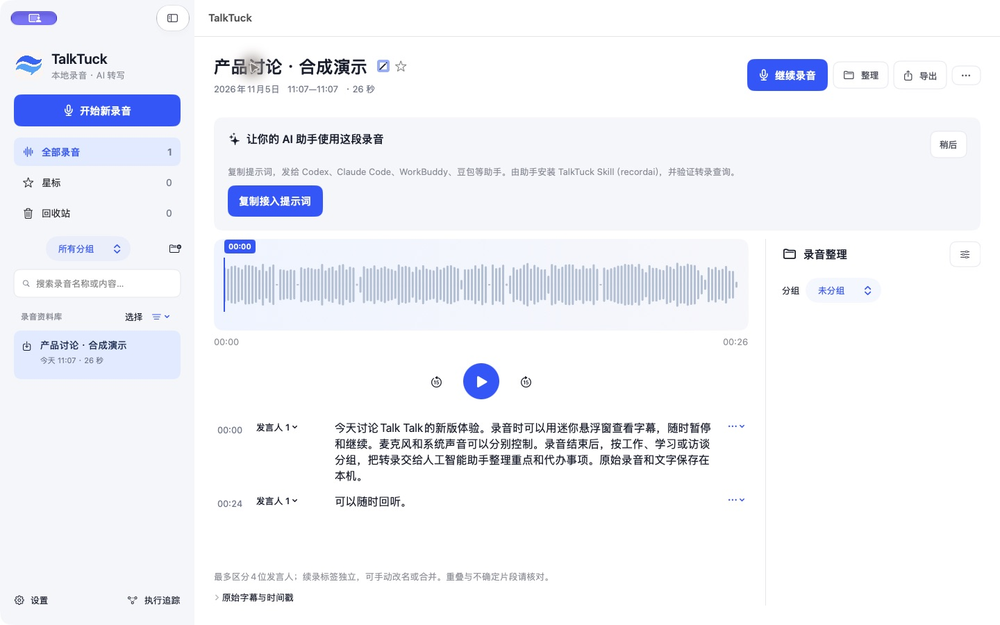

# TalkTuck for macOS（原 RecordAI）

把声音留下来，把转录交给你习惯的 Agent。

**本仓库公开的是 TalkTuck 的 Mac 版（macOS 原生客户端）源码、构建脚本和相关文档。** iPhone 与 Apple Watch 版属于独立工程，不包含在本仓库中。

TalkTuck 是 macOS 本地录音与转录应用。支持录音、音频导入、原音回听、转录校正和分组，并通过 CLI / MCP 让本机 Agent 查询转录内容。支持简体中文与 English 界面，界面语言与转录语言分别设置。

**This repository contains the macOS client source code for TalkTuck, formerly RecordAI.**

[产品介绍](https://xueshengguo.com/apps/talktuck/) · [个人主页](https://xueshengguo.com/) · [GitHub Releases](https://github.com/xsg22/talktuck/releases)

**[下载 Mac 0.17.2（44）](https://github.com/xsg22/talktuck/releases/tag/v0.17.2)** · [DMG](https://github.com/xsg22/talktuck/releases/download/v0.17.2/TalkTuck-0.17.2-arm64.dmg) · [PKG](https://github.com/xsg22/talktuck/releases/download/v0.17.2/TalkTuck-0.17.2-arm64.pkg)

适用于 Apple Silicon、macOS 14 或更新版本。安装包、应用名称与图标均已统一为 TalkTuck；首次使用需下载语音模型。该包是功能验证预发布，采用本地签名，尚未经过 Apple 公证。

## 在 Mac 上可以做什么

- **mini 悬浮窗**：工作时查看双行实时字幕，随时暂停、继续或结束录音。
- **音源切换**：选择麦克风、系统声音或两路一起录，录音中可分别开关。
- **录音分组**：按工作、学习、访谈等方式整理资料，配合搜索和星标找回内容。
- **转录与回听**：导入已有音频，按段落定位原音，校正文字并导出 Markdown / SRT。
- **Agent 接入**：让 Codex、Claude Code 等本机 Agent 通过 Skill、CLI 或 MCP 查询录音和转录，按需整理重点。

## 产品实拍 · macOS 0.17.2（44）

以下截图来自本版正式构建的原生客户端，使用独立资料目录和合成语音，不含私人录音、手机号或登录凭据。截图与本次验证范围见[发布验证记录](Docs/validation/release-0.17.2/README.md)。

### 录音、转录和原音回听

用紧凑的段落查看发言内容，点击时间定位原音；资料仍保存在本机，Agent 可通过 CLI / MCP 查询定稿。


### 分组整理

按工作、学习或访谈整理录音，分组筛选和全文搜索帮助找回内容；移除分组会保留录音。


### 更清晰的设置导航

录音与转录、本地模型、个人热词、TalkTuck 账号、第三方账号与 Agent 分开管理。界面语言与转录语言可以分别选择。


[完整设计册](Docs/design-v2/index.html) · [逐页验收记录](Docs/UI验收.md) · [截图来源](Docs/images/talktuck-macos/README.md)

## 使用与验证

选择麦克风、系统声音或两者作为音源，录音时可暂停、继续或切换到 mini 录音条；完成后可回放、按时间定位转录并导出。首次使用需要下载语音模型。

没有麦克风也可以从首页导入音频，点击“开始转录”验证效果。已用英文、中英混合与 31 秒双人合成中文样本实测本地转录、发言人分段、段落回放、人工校正和 Markdown / 原始 SRT 导出，详见[实测结果与原始输出](Docs/validation/release-0.17.0/README.md)。样本包含一处“设计组”识别为“测试组”的错误，不代表真实会议总体准确率。

首次使用时，在应用内下载并校验语音模型。模型文件不随源码或安装包分发，参见[模型下载](Docs/模型下载.md)。

## 开发环境

0.17.0 已加入中英文界面（跟随系统 / 简体中文 / English），与中文 / 英语 / 中英自动转录分别设置；已有标题、正文、分组和自定义发言人名称保留原样。已用合成英文与中英混合语音完成真实模型转录和发言人对齐，并实际验收原生客户端导入流程。详见[中英文验证与效果图](Docs/validation/bilingual/README.md)。Windows 目前提供[独立引擎与 WASAPI 验证工具](Platforms/Windows/README.md)，尚未交付 Windows 客户端。

- Apple Silicon、macOS 14 或更新版本
- Xcode 命令行工具、CMake、Python 3.12
- 构建前准备官方 DWS 与 lark-cli 可执行文件，分别放在 `.vendor/dws/dws` 和 `.vendor/lark-cli/lark-cli`。`Scripts/build.zsh` 会校验固定版本的 SHA-256。

本地回归：

```zsh
mkdir -p .build
python3 Scripts/test-recording-entry.py
```

构建应用：

```zsh
COHEAR_STAGE_ONLY=1 RECORD_AI_BUILD_APP_PATH="$PWD/.build/local/TalkTuck.app" /bin/zsh Scripts/build.zsh
```

模型权重、第三方运行时二进制、安装包、录音与授权凭据不纳入仓库。模型推理验收需要另外下载模型和测试音频。


## 构建与发布

重复的回归、打包、签名和安装包内容校验已合并到脚本：

```zsh
zsh Scripts/release.zsh
```

该命令及 GitHub 发布工作流会要求全部 UI 验收通过。仅准备本地候选包可运行 `zsh Scripts/release.zsh --candidate`；它不会发布。

明确选择先交付主功能时，可运行 `zsh Scripts/publish-functional-release.zsh v0.17.0-functional.1`。脚本核对实测证据后推送标签，由 GitHub 重新回归、打包并发布标明 UI 验收状态的功能验证 prerelease；不会修改 UI 验收结果。

详见[发布流程](Docs/发布流程.md)。Python 3.12 和语音引擎随安装包提供，最终用户无需另外安装 Python。

## 统一 Agent 接入

首次获得已保存的非空转录时提示一次；在设置的“Agent 与数据”和交付页也可复制同一份接入提示词。粘贴给本地 Agent 后，由它获取当前版本 Skill 并按自己的环境安装。TalkTuck 不要求选择 Agent，也不直接修改 Agent 配置。

CLI `setup --json`、MCP `get_agent_setup` 和本机 `AgentData/SETUP.md` 提供安装说明。录音控制另有显式 `--launch`、实际状态和命令回执查询，接入测试不会自动录音。详见 [接口与验证说明](Docs/Agent接口.md)。该功能随 0.16.1 功能验证版提供；真实各品牌 Agent 的加载兼容性尚未全部联测。



## 开发预览：自适应分析报告

已实现可复用的 JSON 契约与离线 HTML 渲染器，并用刚才的实际转录生成[首份 HTML 报告](Docs/examples/adaptive-report/output/report.html)和[结构化 JSON](Docs/examples/adaptive-report/output/report.json)。内容块和重点由分析决定，支持行动、知识、观点、对比等不同编排；不强制填满固定会议模板。

示例分析由 Codex 生成；此离线报告工具供外部 Agent 使用，未接入 App 自动总结或手机默认页。当前桌面端聚焦录音资料管理。实现、重复生成命令与验证边界见[自适应分析报告](Docs/自适应分析报告.md)。仓库示例不分发音频，回听需在本机生成完整报告包。

```sh
python3 -m unittest discover -s Tests/reporting -v
```

## 录音资料管理

桌面主流程收敛为录音、转录、回听、分组与 Agent 接入。主阅读页直接展示转录正文，移除时间点、重复的时间线，以及内置笔记、摘要、问答、Live Q&A 和行动项的全部操作入口。转录采用时间、发言人、正文同一行的紧凑布局；右侧仅保留录音分组。设置分开管理语音识别模型、个人热词、TalkTuck 账号、第三方账号与 Agent 接入。旧版保存的历史内容继续保存在磁盘上，分析由外部 Agent 按需处理。

- 一层分组，支持创建、重命名、移除、筛选与批量移动；已按最新范围移除标签功能，压缩侧栏控件，为录音列表留出更多空间。
- 旧转录在阅读层合并短碎段并保留原始引用；新转录在发言人对齐后抑制连续短碎段，不强行合并完整短答。
- CLI/MCP 可按分组、录音标题和正文查找，整理信息使用独立版本，不使正文引用失效。

上述功能随 0.16.2 功能验证版交付。详细契约、兼容规则与验证命令见[资料管理说明](Docs/产品定位与资料管理.md)，当前安装包证据见[本版验证记录](Docs/validation/release-0.17.2/README.md)。私人音频和截图不作为公开示例提交。

```zsh
zsh Scripts/test-library-management.zsh
```

## 联系方式

邮箱：[xsgnzb1@gmail.com](mailto:xsgnzb1@gmail.com)

微信公众号：**李昂的数字之旅**，使用微信扫码关注。


